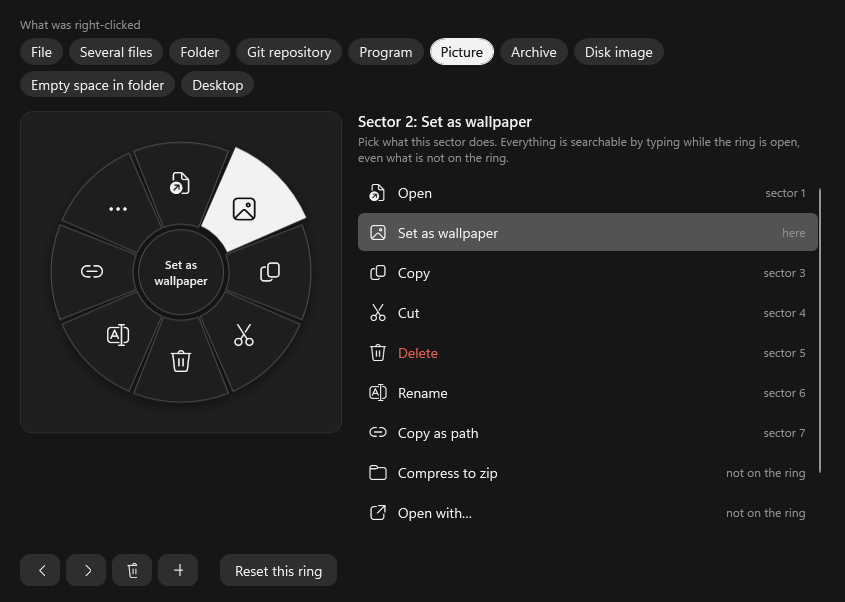

<p align="center">
  
</p>

<p align="center">
  <b>A faster right click for File Explorer and the desktop on Windows 11.</b><br>
  Right-click, pick a sector, done. No "Show more options", no hunting through a long list.
</p>

<p align="center">
  <a href="https://github.com/TaCeiN/Radii/releases/latest"></a>
  <a href="https://github.com/TaCeiN/Radii/actions/workflows/build.yml"></a>
  
  <a href="LICENSE"></a>
</p>

<p align="center"><b>English</b> · <a href="README.ru.md">Русский</a></p>

<p align="center"></p>

## Why

Windows 11 split the right-click menu in two: the short modern one, and everything else behind *Show more options*. Copy, rename, "open in terminal", your 7-Zip and Git entries — it's always one more click and a scroll away.

Radii swaps that menu for a ring. You right-click, the ring opens under the cursor, you click a sector. The things you do most are always in the same place, so after a day your hand knows where *Copy* or *Rename* is without looking.

## What it does

**The ring knows what you clicked.** A picture gets *Set as wallpaper*, a folder gets *Open in Terminal*, an installer gets
*Run as admin*, an archive gets *Extract here*, a Git repo gets *Open on GitHub*. Copy, Cut, Delete and Rename never move. Everything else from the Windows menu — 7-Zip, Git, VS Code, Defender, Send to and the rest — is one click away in the
**Extensions** sector, with their real icons and submenus.

**Shift + right click converts.** The ring turns into the formats this file can become: a photo to WebP, AVIF or PDF, a video to MP4 or GIF, a DOCX to PDF, JSON to YAML, a folder to ZIP. The result lands next to the original, the original is never touched.

<p align="center"></p>

**Ctrl + right click edits.** Small windows for the quick jobs you would otherwise open a big app for: crop or resize a photo, give it a look, squeeze it under a size, trim a video or a song, merge PDFs, strip metadata, rename a hundred files at once. Every tool saves a new file.

<p align="center"></p>

A few more things that make it pleasant to use:

- **Type to search.** While a ring is open, just start typing: every action, every editor, every shell extension is searchable.
- **Keyboard friendly.** Arrows or the wheel move the highlight, `Enter` runs, `Esc` closes, `←`/`→` (or `A`/`D`) switch between the ring, the converter and the editors.
- **Your ring, your way.** Choose what sits in every sector for files, folders, pictures, programs, the desktop… Add your own commands.
- **Looks like it belongs.** Six colour schemes, light and dark, frosted-glass background, animations you can turn off.

## Install

1. Download **`Radii-Setup-x.y.z.exe`** from [Releases](https://github.com/TaCeiN/Radii/releases/latest) and run it. No .NET, no administrator rights. Windows SmartScreen may warn you because the file is not code-signed yet: *More info → Run anyway*.
2. Pick **Automatic** and wait, or **Manual** to choose the folder, shortcuts and which conversion engines to download now.

| Automatic or manual | Manual options |
|---|---|
|  |  |

That's it: right-click a file in Explorer. The tray icon opens the settings.

The conversion engines (FFmpeg, ImageMagick, Pandoc, about 165 MB together) are downloaded once — by the installer, or the first time a conversion needs one. Word, Excel and PowerPoint files go through Microsoft Office when you have it; without Office, LibreOffice is downloaded the first time you convert such a file.

**Update:** Radii checks for a new version at start and once a day and asks before doing anything. You can also just run a newer installer over the old one.

**Uninstall:** *Settings → Apps*, or run the installer again and choose *Uninstall*.

## Make it yours

<p align="center"></p>

- **Edit the ring…** shows the real ring for a file, a folder, a picture, a program, the desktop and more. Click a sector and pick what it does. Whatever is not on the ring is still found by typing.
- **Your commands:** any program with arguments, per file type, optionally as administrator. Placeholders: `{path}` `{paths}` `{folder}` `{name}` `{stem}` `{ext}` (`{path}` is not quoted, add quotes yourself).
- Sort sectors by how often you use them, hide the ones you never touch, change the ring size, theme and colour scheme.
- Need the classic Windows menu? It's the last tile in **Extensions** (`Shift+F10`). Turn off "Shift + right click opens the converter" and Shift + right click shows the native menu again, or switch Radii off from the tray in one click.

Settings live in `%APPDATA%\Radii\settings.json` and apply immediately.

<details>
<summary><b>The settings window</b></summary>

<p align="center"></p>

</details>

## Privacy and safety

Radii needs a low-level mouse and keyboard hook to catch the right click before Explorer does, so here is exactly what it does:

- It only reacts to real clicks over Explorer and desktop file views. Nothing you type or click is recorded or sent anywhere.
- The one background request is the update check: a single HTTPS call to `api.github.com` with a User-Agent and nothing else. It can be turned off in settings.
- Engines are downloaded only when you choose them or use them. An update is verified against the release's `SHA256SUMS.txt` before it runs.
- Every release ships with `SHA256SUMS.txt`; check it with `Get-FileHash .\Radii-Setup-x.y.z.exe` if you like.

Found a security problem? See [SECURITY.md](SECURITY.md).

## Reference

<details>
<summary><b>What is in each ring</b></summary>

Every ring keeps the same places, clockwise from the top, so an action never moves:

| Place | What it is |
|---|---|
| 1 | Open (Run for programs) |
| 2 | Depends on the item: Set as wallpaper · Open in Terminal · Run as admin · Extract here · Mount · otherwise Compress to zip |
| 3, 4, 5 | Copy, Cut, Delete |
| 6 | Rename (several items: Move to new folder) |
| 7 | Copy as path (a Git repository with a remote: Open on GitHub) |
| 8 | Extensions: the rest of the Windows menu |

Empty space in a folder: Paste, New folder, Refresh, Select all, Terminal here. On the desktop: Paste, New folder, Refresh, Display settings, Personalize.
*Open with…*, *SHA-256* and *Properties* are found by typing or can be put on the ring in the ring editor.

</details>

<details>
<summary><b>Converter formats</b></summary>

| Files | Converted to | Engine |
|---|---|---|
| Pictures: PNG JPG BMP GIF TIFF ICO WebP HEIC AVIF JXL SVG PSD TGA DDS EXR RAW… | PNG JPG WebP BMP GIF TIFF ICO AVIF PDF (several pictures into one PDF) | Windows imaging, ImageMagick for the rest |
| Video: MP4 MKV AVI MOV WebM WMV FLV 3GP TS MPG… | MP4 MKV WebM MOV AVI GIF, audio only (MP3 AAC WAV FLAC OGG OPUS AIFF WMA), smaller 1080/720/480/360p | FFmpeg |
| Audio: MP3 WAV FLAC AAC M4A OGG OPUS WMA AIFF AC3… | MP3 AAC WAV FLAC OGG OPUS AIFF WMA | FFmpeg |
| Documents: MD TXT HTML DOCX ODT RTF EPUB TeX RST | PDF DOCX HTML MD TXT EPUB ODT RTF | Pandoc (+ Edge or Chrome for PDF) |
| Office: DOC XLS XLSX ODS PPT PPTX ODP CSV | PDF, DOCX/XLSX/PPTX/ODT/ODS/ODP, CSV, slides to PNG | Microsoft Office if installed, else LibreOffice |
| PDF | PNG or JPG, every page | Windows PDF renderer |
| Data: JSON YAML XML TOML CSV TSV | each other | built in |
| Archives and folders: ZIP 7z TAR GZ BZ2 XZ RAR | ZIP 7z TAR TAR.GZ | Windows `tar.exe` |
| Text files | UTF-8, UTF-8 BOM, UTF-16, Windows-1251, CP866, KOI8-R; LF or CRLF line endings | built in |

Engines live in `%APPDATA%\Radii\engines`.

</details>

<details>
<summary><b>Editors</b></summary>

| Files | Tools |
|---|---|
| Pictures | crop and rotate, resize, colour and light (with looks), compress to a size |
| Video | trim (exact or fast cut), crop, remove sound, change speed, frame to picture, piece to GIF |
| Audio | trim on the waveform, join several files, volume / normalise / speed / cut silence with live listening |
| PDF | merge, pages (extract, rotate, reorder, delete), compress |
| Anything | remove metadata; bulk rename with undo (when several files are selected) |

</details>

<details>
<summary><b>How it works, for the curious</b></summary>

- A low-level mouse hook swallows the right click over Explorer's item view (press **and** release), so the native menu never opens and Explorer never thinks a button is still held.
- What you clicked is read through UI Automation (the selection) and `Shell.Application` (folder and full paths).
- The ring is a topmost WPF window that never takes focus, so Explorer keeps it. Most actions are key presses sent with `SendInput` (`Enter`, `Ctrl+C`, `F2`, `Delete`, `Alt+Enter`…); the rest start a process (`runas`, `wt`, `tar`) or run inside Radii.
- **Extensions** is built from the selection's real `IContextMenu`: third-party handlers with their icons and submenus, invoked on the live COM object. Commands the ring already has are filtered out.

</details>

## Build from source

You need the .NET 10 SDK and Windows 10/11 x64.

```powershell
dotnet run -c Release                                             # run it
powershell -ExecutionPolicy Bypass -File tools\build-release.ps1  # dist\Radii-Setup-x.y.z.exe
```

[CONTRIBUTING.md](CONTRIBUTING.md) lists the offscreen renders that let you check the ring, editors, settings and installer without hooking your mouse.

## Author

Made by **TaCeiN**. Questions, ideas, bugs: [Telegram @Tachg](https://t.me/Tachg) or [GitHub issues](https://github.com/TaCeiN/Radii/issues). If Radii saves you a few clicks a day, a ⭐ helps other people find it.

## License

[MIT](LICENSE) © TaCeiN. The photo in the demo is from [Unsplash](https://unsplash.com/photos/HUoVYv3V3PI).
