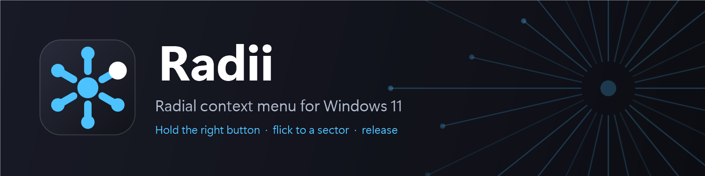
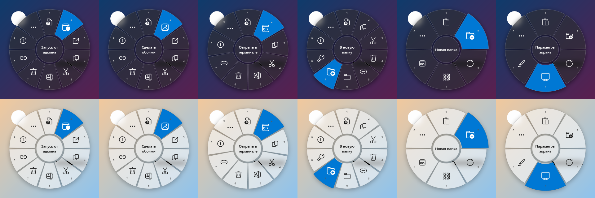
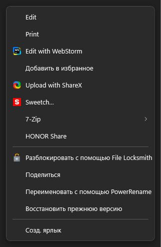
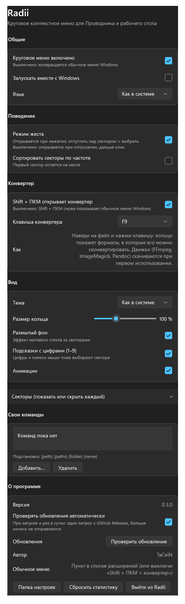
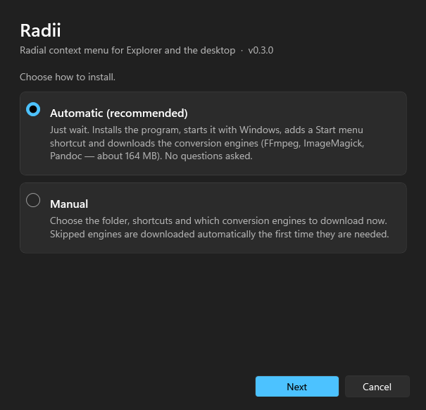
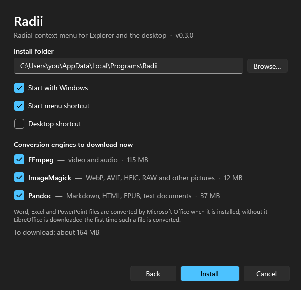

<p align="center">
  
</p>

<p align="center">
  A radial replacement for the right-click menu of File Explorer and the desktop on Windows 11.<br>
  Hold the right button, flick towards a sector, release.
</p>

<p align="center">
  <a href="https://github.com/TaCeiN/Radii/releases/latest"></a>
  <a href="https://github.com/TaCeiN/Radii/actions/workflows/build.yml"></a>
  
  <a href="LICENSE"></a>
</p>

<p align="center"><b>English</b> · <a href="README.ru.md">Русский</a></p>



The ring changes with what you clicked: a file, several files, a folder, an executable, an image, an archive, empty space.
Everything the Windows menu has beyond that (7-Zip, Git, VS Code, …) lives in a flyout list next to the ring.
**Shift + right click** turns the ring into a **file converter** (images, video, audio, documents, Office, PDF, data, archives).

| Extensions flyout (real shell menu of a `.txt`) | Settings (tray icon) |
|---|---|
|  |  |

## Install

1. Download **`Radii-Setup-x.y.z.exe`** from [Releases](https://github.com/TaCeiN/Radii/releases/latest) and run it
   (no .NET needed, no administrator rights; SmartScreen may warn because the file is not code-signed yet — *More info → Run anyway*).
2. Pick a mode:
   - **Automatic** — just wait. Installs the program, starts it with Windows, adds a Start menu shortcut and downloads all conversion
     engines (FFmpeg, ImageMagick, Pandoc, about 165 MB).
   - **Manual** — choose the folder, shortcuts and which engines to download now. Skipped engines are fetched automatically the first
     time a conversion needs them.

| Mode | Manual options |
|---|---|
|  |  |

Uninstall from *Settings → Apps*, or run the installer again (it offers *Uninstall*). Updating = run the new installer over the old one.
Compare the file with `SHA256SUMS.txt` from the release if you like: `Get-FileHash .\Radii-Setup-x.y.z.exe`.

Silent install for scripts: `Radii-Setup-x.y.z.exe --silent [--dir <path>] [--no-engines] [--no-launch]`.

## Updates

The program checks GitHub Releases for a newer version at start and once a day, and asks before doing anything; *Later* just asks again at
the next start. *Update* downloads the installer into the small notification in the bottom-right corner, verifies its SHA-256 against the
release's `SHA256SUMS.txt`, installs it over the old version (settings and engines are kept) and restarts. The check is a single HTTPS
request to `api.github.com` that sends nothing but a User-Agent; it can be turned off in settings, and *Check for updates* there (or in the
tray menu) does it by hand. Engines are downloaded only when you pick them in the installer or use them.

## How it works

- A low-level mouse hook swallows a right click over the shell item view (press **and** release), so the native menu never
  opens and Explorer never thinks a button is held.
- What was clicked is read through UI Automation (selection) and `Shell.Application` (folder and full paths).
- The ring is a never-activated, topmost WPF window, so Explorer keeps focus. Most actions are shortcuts sent with `SendInput`
  (`Enter`, `Ctrl+C`, `F2`, `Delete`, `Alt+Enter`, …); the rest start processes (`runas`, `wt`, `tar`) or run in-process.
- The **Extensions** sector opens a Windows 11 style flyout built from the real `IContextMenu` of the selection: third-party
  handlers, their icons and submenus, invoked on the live COM object. Commands the ring already has are removed from it.
- **Shift + right click** opens the **converter ring**; the native menu is the last row of the extensions flyout (`Shift+F10`),
  or turn the converter shortcut off in settings to get the old Shift bypass back.

## Converter

Shift + right click on a file, or point at it and press the converter key (F9 by default, configurable), and the ring is replaced by
the formats the file can be converted to. The result is saved next to the original (never overwrites); a small notification in the
bottom-right corner shows progress, has a cancel button and, when done, a "Show in folder" link.

| Files | Converted to | Engine |
|---|---|---|
| Pictures: PNG JPG BMP GIF TIFF ICO WebP HEIC AVIF JXL SVG PSD TGA DDS EXR RAW… | PNG JPG WebP BMP GIF TIFF ICO AVIF PDF (several pictures into one PDF) | Windows imaging; ImageMagick for the rest |
| Video: MP4 MKV AVI MOV WebM WMV FLV 3GP TS MPG… | MP4 MKV WebM MOV AVI GIF, audio only (MP3 AAC WAV FLAC OGG OPUS AIFF WMA), shrink to 1080/720/480/360p | FFmpeg |
| Audio: MP3 WAV FLAC AAC M4A OGG OPUS WMA AIFF AC3… | MP3 AAC WAV FLAC OGG OPUS AIFF WMA | FFmpeg |
| Documents: MD TXT HTML DOCX ODT RTF EPUB TeX RST | PDF DOCX HTML MD TXT EPUB ODT RTF | Pandoc (+ Edge/Chrome for PDF) |
| Office: DOC XLS XLSX ODS PPT PPTX ODP CSV | PDF, DOCX/XLSX/PPTX/ODT/ODS/ODP, CSV, slides to PNG | Microsoft Office when installed, else LibreOffice |
| PDF | PNG JPG (every page) | Windows PDF renderer |
| Data: JSON YAML XML TOML CSV TSV | each other | built in |
| Archives and folders: ZIP 7z TAR GZ BZ2 XZ RAR | ZIP 7z TAR TAR.GZ | `tar.exe` from Windows |
| Text files | UTF-8, UTF-8 BOM, UTF-16, Windows-1251, CP866, KOI8-R, LF, CRLF line endings | built in |

The engines live in `%APPDATA%\Radii\engines` and are downloaded once (by the installer, or the first time they are needed).

## Use

- **Gesture:** hold the right button, move towards a sector, release. A plain click opens the ring and waits for a click.
- **Keys while the ring is open:** `1`–`9` pick a sector, arrows or the mouse wheel move the highlight, `Enter` confirms, `Esc` closes.
- **Tray icon:** left click opens settings; menu toggles the ring and exits.

## Menus

| Click on | Sectors |
|---|---|
| Empty space in Explorer | Paste, New folder, Refresh, Select all, Terminal here |
| Empty space on desktop | Paste, New folder, Refresh, Display settings, Personalize |
| File | Open, Open with…, Copy, Cut, Rename, Delete, Copy as path, Convert…, Properties |
| Executable / script / installer / shortcut | + **Run as admin** |
| Folder | + Open in Terminal |
| Git repository | + Open on GitHub (from `.git/config`) |
| Image (png, jpg, bmp) | + Set as wallpaper |
| Archive (zip, 7z, tar, gz, rar) | + Extract here |
| Disk image (iso, vhd, vhdx) | + Mount |
| Several items | Open, Copy, Cut, Delete, Copy as path, Compress to zip, Move to new folder, SHA-256, Properties |

Every menu ends with **Extensions**. Sectors can be hidden, your own commands added, and sorting by usage turned on in settings.

## Settings

`%APPDATA%\Radii\settings.json`, edited from the tray window (changes apply at once):
theme, ring size, blurred background, number hints, animations, gesture mode, language, autostart, per-sector visibility,
usage sorting, converter shortcut, and **own commands** (program + arguments with `{path}` `{paths}` `{folder}` `{name}`, per file type, optionally elevated).

## Build from source

Needs the .NET 10 SDK and Windows 10/11 x64.

```powershell
dotnet run -c Release                                             # run
powershell -ExecutionPolicy Bypass -File tools\build-release.ps1  # dist\Radii-Setup-x.y.z.exe
```

See [CONTRIBUTING.md](CONTRIBUTING.md) for the diagnostics that need no hook (offscreen renders of the ring, flyout, settings and installer).

## Author

Made by **TaCeiN**. Questions, ideas, bug reports: [Telegram @Tachg](https://t.me/Tachg) or [GitHub issues](https://github.com/TaCeiN/Radii/issues).

## License

[MIT](LICENSE) © TaCeiN
