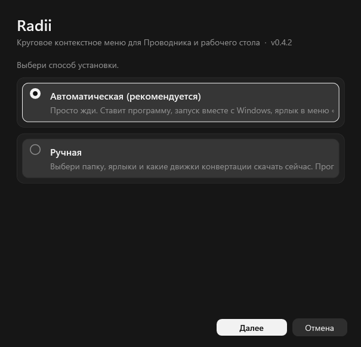
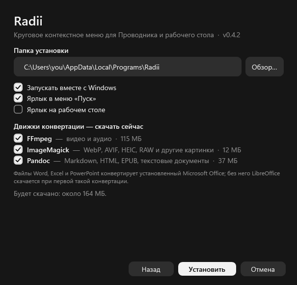

<p align="center">
  
</p>

<p align="center">
  Круговая замена правого клика в Проводнике и на рабочем столе Windows 11.<br>
  Зажми правую кнопку, двинь к нужному сектору, отпусти.
</p>

<p align="center">
  <a href="https://github.com/TaCeiN/Radii/releases/latest"></a>
  <a href="https://github.com/TaCeiN/Radii/actions/workflows/build.yml"></a>
  
  <a href="LICENSE"></a>
</p>

<p align="center"><a href="README.md">English</a> · <b>Русский</b></p>


Круг меняется в зависимости от того, по чему кликнули: файл, несколько файлов, папка, программа, картинка, архив, пустое место.
Всё остальное из меню Windows (7-Zip, Git, VS Code, …) лежит в списке-флайауте рядом с кругом.
**Shift + правый клик** превращает круг в **конвертер файлов** (картинки, видео, аудио, документы, Office, PDF, данные, архивы).

| Флайаут расширений (настоящее меню оболочки для `.txt`) | Настройки (значок в трее) |
|---|---|
|  |  |

## Установка

1. Скачай **`Radii-Setup-x.y.z.exe`** со страницы [Releases](https://github.com/TaCeiN/Radii/releases/latest) и запусти
   (.NET не нужен, права администратора не нужны; SmartScreen может предупредить, потому что файл пока не подписан — *Подробнее → Выполнить в любом случае*).
2. Выбери режим:
   - **Автоматический** — просто жди. Ставит программу, запуск вместе с Windows, ярлык в меню «Пуск» и скачивает все движки конвертации
     (FFmpeg, ImageMagick, Pandoc, около 165 МБ).
   - **Ручной** — выбираешь папку, ярлыки и какие движки скачать сейчас. Пропущенные движки скачаются сами при первой конвертации,
     которой они нужны.

| Режим | Параметры ручной установки |
|---|---|
|  |  |

Удалить можно в *Параметры → Приложения* или повторным запуском установщика (там есть кнопка «Удалить»). Обновление — запустить новый установщик поверх старой версии.
Хочешь проверить файл — сравни с `SHA256SUMS.txt` из релиза: `Get-FileHash .\Radii-Setup-x.y.z.exe`.

Тихая установка для скриптов: `Radii-Setup-x.y.z.exe --silent [--dir <путь>] [--no-engines] [--no-launch]`.

## Обновления

Программа проверяет GitHub Releases на новую версию при запуске и раз в сутки и ничего не делает без вопроса; «Позже» — спросит снова при
следующем запуске. «Обновить» скачивает установщик в маленькое уведомление справа внизу, сверяет SHA-256 с `SHA256SUMS.txt` из релиза,
ставит поверх старой версии (настройки и движки сохраняются) и перезапускается. Проверка — один HTTPS-запрос к `api.github.com`, в нём
уходит только User-Agent; её можно отключить в настройках, а кнопка «Проверить обновление» там же (и в меню трея) делает это вручную.
Движки скачиваются только если ты выбрал их в установщике или пользуешься ими.

## Как это работает

- Низкоуровневый хук мыши перехватывает правый клик над списком файлов Проводника (нажатие **и** отпускание), поэтому обычное меню не открывается,
  а Проводник не думает, что кнопка зажата.
- Что нажали — читается через UI Automation (выделение) и `Shell.Application` (папка и полные пути).
- Круг — это никогда не активирующееся окно WPF поверх всех, поэтому фокус остаётся у Проводника. Большинство действий — сочетания клавиш через `SendInput`
  (`Enter`, `Ctrl+C`, `F2`, `Delete`, `Alt+Enter`, …); остальное запускает процессы (`runas`, `wt`, `tar`) или выполняется внутри программы.
- Сектор **Расширения** открывает флайаут в стиле Windows 11 из настоящего `IContextMenu` выделения: сторонние обработчики, их значки и подменю,
  вызываются на живом COM-объекте. Команды, которые уже есть в круге, оттуда убираются.
- **Shift + правый клик** открывает **круг конвертера**; обычное меню — последняя строка флайаута (`Shift+F10`), либо отключи это сочетание в настройках,
  чтобы Shift снова вызывал обычное меню.

## Конвертер

Зажми Shift и нажми правой кнопкой по файлу (или нажми плашку «Конвертер» у круга) — круг заменится форматами,
в которые файл можно превратить. Результат сохраняется рядом с оригиналом (ничего не перезаписывает); уведомление справа снизу показывает прогресс,
имеет кнопку отмены и по завершении — ссылку «Показать в папке».

| Файлы | Во что | Движок |
|---|---|---|
| Картинки: PNG JPG BMP GIF TIFF ICO WebP HEIC AVIF JXL SVG PSD TGA DDS EXR RAW… | PNG JPG WebP BMP GIF TIFF ICO AVIF PDF (несколько картинок в один PDF) | Windows imaging; ImageMagick для остального |
| Видео: MP4 MKV AVI MOV WebM WMV FLV 3GP TS MPG… | MP4 MKV WebM MOV AVI GIF, только звук (MP3 AAC WAV FLAC OGG OPUS AIFF WMA), сжатие до 1080/720/480/360p | FFmpeg |
| Аудио: MP3 WAV FLAC AAC M4A OGG OPUS WMA AIFF AC3… | MP3 AAC WAV FLAC OGG OPUS AIFF WMA | FFmpeg |
| Документы: MD TXT HTML DOCX ODT RTF EPUB TeX RST | PDF DOCX HTML MD TXT EPUB ODT RTF | Pandoc (+ Edge/Chrome для PDF) |
| Office: DOC XLS XLSX ODS PPT PPTX ODP CSV | PDF, DOCX/XLSX/PPTX/ODT/ODS/ODP, CSV, слайды в PNG | Microsoft Office, если установлен, иначе LibreOffice |
| PDF | PNG JPG (каждая страница) | Просмотрщик PDF из Windows |
| Данные: JSON YAML XML TOML CSV TSV | друг в друга | встроено |
| Архивы и папки: ZIP 7z TAR GZ BZ2 XZ RAR | ZIP 7z TAR TAR.GZ | `tar.exe` из Windows |
| Текстовые файлы | UTF-8, UTF-8 BOM, UTF-16, Windows-1251, CP866, KOI8-R, переводы строк LF, CRLF | встроено |

Движки лежат в `%APPDATA%\Radii\engines` и скачиваются один раз (установщиком или при первой нужде).

## Редакторы

Зажми Ctrl и нажми правой кнопкой (или нажми плашку «Правка» у круга) — откроются маленькие окна для быстрой правки файла.
Результат всегда сохраняется новым файлом рядом с оригиналом.

| Файлы | Инструменты |
|---|---|
| Картинки | обрезка и поворот, размер, цвет и свет, сжатие до нужного веса |
| Видео | обрезка (точная или быстрая), кадрирование, убрать звук, скорость, кадр в картинку, фрагмент в GIF |
| Аудио | обрезка по волне, склейка, громкость / нормализация / скорость / вырезание тишины (есть кнопка прослушивания) |
| PDF | склейка, разделение, страницы (достать, повернуть, переставить, удалить), сжатие |
| Любые | очистка метаданных, пакетное переименование с отменой (только для нескольких файлов) |

Под каждым кругом плашки переключают обычный круг, конвертер и правку; то же делают `←`/`→` и `A`/`D`.

## Использование

- **Открыть:** правый клик; круг появляется там, где отпустил кнопку, и ждёт клика по сектору.
- **Клавиши при открытом круге:** стрелки или колесо мыши двигают подсветку, `Enter` подтверждает, `Esc` закрывает.
- **Поиск:** просто печатай при открытом кольце: ищет по всем действиям кольца (и внутри групп) и по расширениям оболочки, `↑`/`↓` выбор, `Enter` запуск, `Esc` сброс.
  Если слово начинается на A или D, начни со `/` (эти две клавиши переключают режимы кольца).
- **Ещё:** если секторов больше 11, хвост уходит в сектор **Ещё**, он открывает малое кольцо.
- **Значок в трее:** левый клик открывает настройки; меню включает/выключает круг и выходит.

## Меню

| Клик по | Секторы |
|---|---|
| Пустое место в Проводнике | Вставить, Новая папка, Обновить, Выделить всё, Терминал здесь |
| Пустое место на рабочем столе | Вставить, Новая папка, Обновить, Параметры экрана, Персонализация |
| Файл | Открыть, Открыть с помощью…, Копировать, Вырезать, Переименовать, Удалить, Копировать путь, Конвертировать…, Свойства |
| Программа / скрипт / установщик / ярлык | + **Запуск от админа** |
| Папка | + Открыть в терминале |
| Git-репозиторий | + Открыть на GitHub (из `.git/config`) |
| Картинка (png, jpg, bmp) | + Сделать обоями |
| Архив (zip, 7z, tar, gz, rar) | + Распаковать сюда |
| Образ диска (iso, vhd, vhdx) | + Подключить |
| Несколько элементов | Открыть, Копировать, Вырезать, Удалить, Копировать путь, Сжать в zip, В новую папку, SHA-256, Свойства |

Каждое меню заканчивается сектором **Расширения**. В настройках можно скрывать секторы, добавлять свои команды и включать сортировку по частоте.

## Настройки

`%APPDATA%\Radii\settings.json`, редактируется из окна в трее (применяется сразу):
тема, размер круга, размытие фона, анимации, язык, автозапуск, видимость секторов,
сортировка по частоте, сочетание конвертера и **свои команды** (программа + аргументы с `{path}` `{paths}` `{folder}` `{name}` `{stem}` `{ext}`; `{path}` без кавычек, ставь сам; по типу файла, можно с правами админа).

## Сборка из исходников

Нужен .NET 10 SDK и Windows 10/11 x64.

```powershell
dotnet run -c Release                                             # запуск
powershell -ExecutionPolicy Bypass -File tools\build-release.ps1  # dist\Radii-Setup-x.y.z.exe
```

Диагностика без хука (оффскрин-рендеры круга, флайаута, настроек и установщика) описана в [CONTRIBUTING.md](CONTRIBUTING.md).

## Автор

Делает **TaCeiN**. Вопросы, идеи, баги: [Telegram @Tachg](https://t.me/Tachg) или [GitHub issues](https://github.com/TaCeiN/Radii/issues).

## Лицензия

[MIT](LICENSE) © TaCeiN
