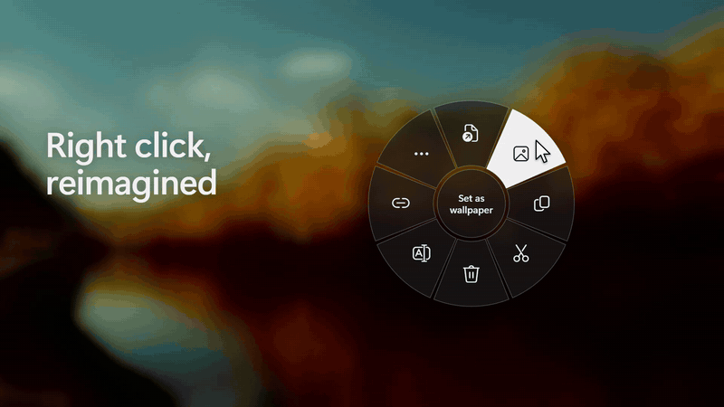
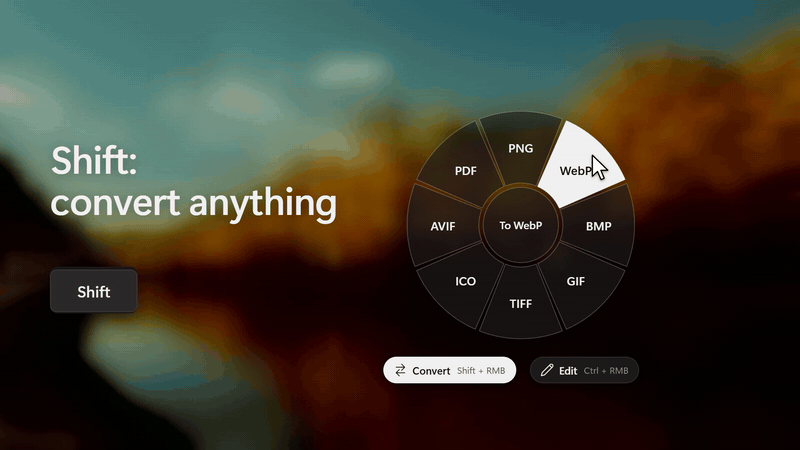
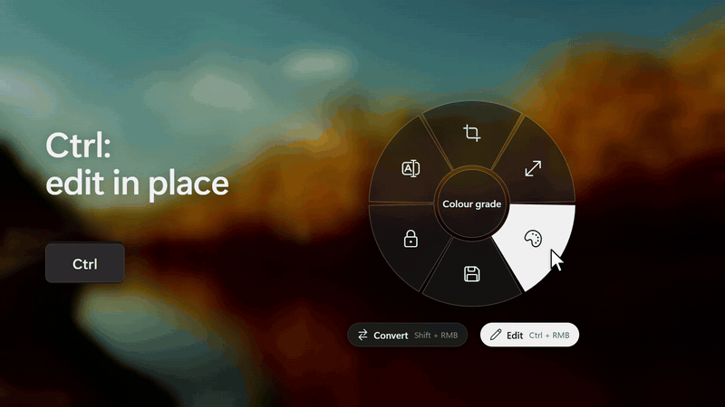
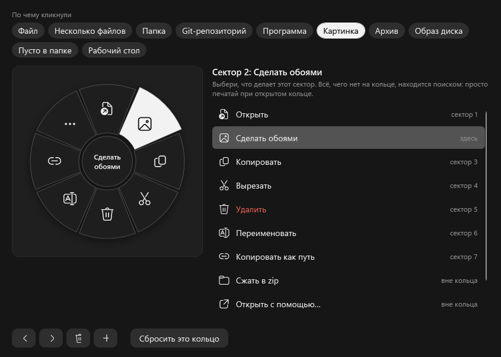
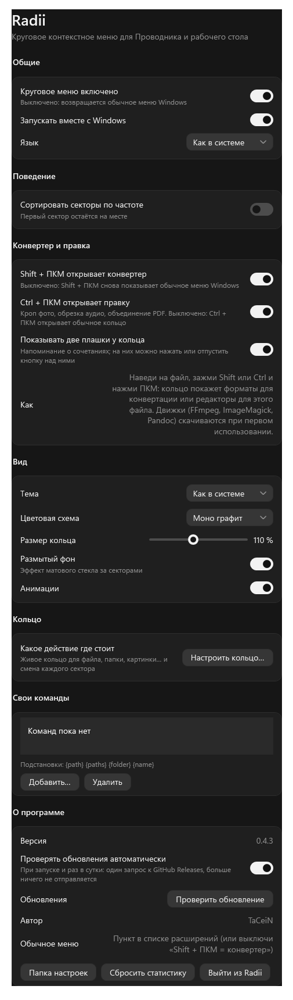

<p align="center">
  
</p>

<p align="center">
  <b>Быстрый правый клик для Проводника и рабочего стола Windows 11.</b><br>
  Правый клик, выбрал сектор, готово. Без «Показать дополнительные параметры» и прокрутки длинного списка.
</p>

<p align="center">
  <a href="https://github.com/TaCeiN/Radii/releases/latest"></a>
  <a href="https://github.com/TaCeiN/Radii/actions/workflows/build.yml"></a>
  
  <a href="LICENSE"></a>
</p>

<p align="center"><a href="README.md">English</a> · <b>Русский</b></p>

<p align="center"></p>

## Зачем

В Windows 11 контекстное меню разрезали надвое: короткое новое и всё остальное за пунктом «Показать дополнительные параметры». Копировать, переименовать, открыть в терминале, пункты 7-Zip и Git — каждый раз лишний клик и прокрутка.

Radii заменяет это меню кольцом. Нажимаешь правой кнопкой, кольцо открывается под курсором, кликаешь по сектору. Частые действия всегда на одних и тех же местах, так что через день рука сама знает, где «Копировать» и «Переименовать».

## Что умеет

**Кольцо понимает, по чему кликнули.** У картинки есть «Сделать обоями», у папки — «Открыть в терминале», у установщика — «Запуск от админа», у архива — «Распаковать», у Git-репозитория — «Открыть на GitHub». Копировать, Вырезать, Удалить и Переименовать никогда не переезжают. Всё остальное из меню Windows — 7-Zip, Git, VS Code, Defender, «Отправить» и прочее — в секторе **Расширения**, с настоящими значками и подменю.

**Shift + правый клик — конвертер.** Кольцо превращается в форматы, в которые можно перегнать файл: фото в WebP, AVIF или PDF, видео в MP4 или GIF, DOCX в PDF, JSON в YAML, папку в ZIP. Результат появляется рядом, оригинал не трогается.

<p align="center"></p>

**Ctrl + правый клик — правка.** Маленькие окна для быстрых задач, ради которых обычно открывают большую программу: обрезать или уменьшить фото, наложить фильтр, ужать до нужного веса, обрезать видео или песню, склеить PDF, убрать метаданные, переименовать сотню файлов разом. Каждый инструмент сохраняет новый файл.

<p align="center"></p>

И ещё по мелочи:

- **Поиск набором.** Пока кольцо открыто, просто начни печатать: ищутся все действия, редакторы и расширения оболочки.
- **Клавиатура.** Стрелки или колесо двигают подсветку, `Enter` запускает, `Esc` закрывает, `←`/`→` (или `A`/`D`) переключают кольцо, конвертер и правку.
- **Кольцо под себя.** Выбери, что стоит в каждом секторе для файлов, папок, картинок, программ, рабочего стола… Добавь свои команды.
- **Выглядит как часть системы.** Шесть цветовых схем, светлая и тёмная тема, матовое стекло, анимации можно выключить.

## Установка

1. Скачай **`Radii-Setup-x.y.z.exe`** со страницы [Releases](https://github.com/TaCeiN/Radii/releases/latest) и запусти. .NET и права администратора не нужны. SmartScreen может предупредить, потому что файл пока не подписан: *Подробнее → Выполнить в любом случае*.
2. Выбери **Автоматическую** установку и жди, или **Ручную**, чтобы выбрать папку, ярлыки и какие движки конвертации скачать сразу.

| Автоматически или вручную | Параметры ручной установки |
|---|---|
|  |  |

Всё: нажми правой кнопкой по файлу в Проводнике. Значок в трее открывает настройки.

Движки конвертации (FFmpeg, ImageMagick, Pandoc, вместе около 165 МБ) скачиваются один раз — установщиком или при первой конвертации, которой они нужны. Word, Excel и PowerPoint конвертируются через Microsoft Office, если он стоит; без Office при первой такой конвертации скачивается LibreOffice.

**Обновление:** Radii проверяет новую версию при запуске и раз в сутки и ничего не делает без вопроса. Можно и просто запустить новый установщик поверх старого.

**Удаление:** *Параметры → Приложения* или повторный запуск установщика → «Удалить».

## Под себя

<p align="center"></p>

- **Настроить кольцо…** показывает настоящее кольцо для файла, папки, картинки, программы, рабочего стола и других случаев. Кликни сектор и выбери, что он делает. То, чего нет в кольце, всё равно находится поиском.
- **Свои команды:** любая программа с аргументами, для нужных типов файлов, при желании от администратора. Подстановки: `{path}` `{paths}` `{folder}` `{name}` `{stem}` `{ext}` (`{path}` без кавычек, ставь их сам).
- Сортировка секторов по частоте, скрытие ненужных, размер кольца, тема и цветовая схема.
- Нужно обычное меню Windows? Это последняя плитка в **Расширениях** (`Shift+F10`). Выключи «Shift + ПКМ открывает конвертер» — и Shift + правый клик снова покажет родное меню. Или выключи Radii одним кликом в трее.

Настройки лежат в `%APPDATA%\Radii\settings.json` и применяются сразу.

<details>
<summary><b>Окно настроек</b></summary>

<p align="center"></p>

</details>

## Приватность и безопасность

Чтобы поймать правый клик раньше Проводника, Radii ставит низкоуровневый хук мыши и клавиатуры. Вот что он делает на самом деле:

- Реагирует только на настоящие клики над списками файлов Проводника и рабочего стола. Ничего из набранного и нажатого не записывается и никуда не уходит.
- Единственный фоновый запрос — проверка обновлений: один HTTPS-запрос к `api.github.com`, в нём только User-Agent. Отключается в настройках.
- Движки скачиваются, только если ты их выбрал или ими пользуешься. Обновление перед запуском сверяется с `SHA256SUMS.txt` релиза.
- К каждому релизу приложен `SHA256SUMS.txt`; проверить файл можно командой `Get-FileHash .\Radii-Setup-x.y.z.exe`.

Нашёл уязвимость — смотри [SECURITY.md](SECURITY.md).

## Справка

<details>
<summary><b>Что в каждом кольце</b></summary>

Места в кольце постоянные, по часовой стрелке от верха, поэтому действие никогда не переезжает:

| Место | Что там |
|---|---|
| 1 | Открыть (у программ — Запустить) |
| 2 | Зависит от объекта: Сделать обоями · Открыть в терминале · Запуск от админа · Распаковать · Смонтировать · иначе Сжать в zip |
| 3, 4, 5 | Копировать, Вырезать, Удалить |
| 6 | Переименовать (несколько объектов — В новую папку) |
| 7 | Копировать как путь (Git-репозиторий с remote — Открыть на GitHub) |
| 8 | Расширения: остальное меню Windows |

Пустое место в папке: Вставить, Новая папка, Обновить, Выделить всё, Терминал здесь. Рабочий стол: Вставить, Новая папка, Обновить, Параметры экрана, Персонализация. «Открыть с помощью…», SHA-256 и «Свойства» находятся поиском или ставятся в кольцо через редактор кольца.

</details>

<details>
<summary><b>Форматы конвертера</b></summary>

| Файлы | Во что | Движок |
|---|---|---|
| Картинки: PNG JPG BMP GIF TIFF ICO WebP HEIC AVIF JXL SVG PSD TGA DDS EXR RAW… | PNG JPG WebP BMP GIF TIFF ICO AVIF PDF (несколько картинок в один PDF) | Windows imaging, ImageMagick для остального |
| Видео: MP4 MKV AVI MOV WebM WMV FLV 3GP TS MPG… | MP4 MKV WebM MOV AVI GIF, только звук (MP3 AAC WAV FLAC OGG OPUS AIFF WMA), уменьшить до 1080/720/480/360p | FFmpeg |
| Аудио: MP3 WAV FLAC AAC M4A OGG OPUS WMA AIFF AC3… | MP3 AAC WAV FLAC OGG OPUS AIFF WMA | FFmpeg |
| Документы: MD TXT HTML DOCX ODT RTF EPUB TeX RST | PDF DOCX HTML MD TXT EPUB ODT RTF | Pandoc (+ Edge или Chrome для PDF) |
| Office: DOC XLS XLSX ODS PPT PPTX ODP CSV | PDF, DOCX/XLSX/PPTX/ODT/ODS/ODP, CSV, слайды в PNG | Microsoft Office, если есть, иначе LibreOffice |
| PDF | PNG или JPG, каждая страница | просмотрщик PDF Windows |
| Данные: JSON YAML XML TOML CSV TSV | друг в друга | встроено |
| Архивы и папки: ZIP 7z TAR GZ BZ2 XZ RAR | ZIP 7z TAR TAR.GZ | `tar.exe` из Windows |
| Текстовые файлы | UTF-8, UTF-8 BOM, UTF-16, Windows-1251, CP866, KOI8-R; переводы строк LF или CRLF | встроено |

Движки лежат в `%APPDATA%\Radii\engines`.

</details>

<details>
<summary><b>Редакторы</b></summary>

| Файлы | Инструменты |
|---|---|
| Картинки | обрезка и поворот, размер, цвет и свет (с фильтрами), сжатие до нужного веса |
| Видео | обрезка (точная или быстрая), кадрирование, убрать звук, скорость, кадр в картинку, фрагмент в GIF |
| Аудио | обрезка по волне, склейка нескольких файлов, громкость / нормализация / скорость / вырезание тишины с прослушиванием на лету |
| PDF | склейка, страницы (достать, повернуть, переставить, удалить), сжатие |
| Любые | очистка метаданных; пакетное переименование с отменой (когда выбрано несколько файлов) |

</details>

<details>
<summary><b>Как это устроено</b></summary>

- Низкоуровневый хук мыши перехватывает правый клик над списком файлов Проводника (нажатие **и** отпускание), поэтому родное меню не открывается, а Проводник не думает, что кнопка зажата.
- Что нажали, читается через UI Automation (выделение) и `Shell.Application` (папка и полные пути).
- Кольцо — окно WPF поверх всех, которое никогда не забирает фокус, поэтому фокус остаётся у Проводника. Большинство действий — нажатия клавиш через `SendInput` (`Enter`, `Ctrl+C`, `F2`, `Delete`, `Alt+Enter`…); остальное запускает процесс (`runas`, `wt`, `tar`) или выполняется внутри Radii.
- **Расширения** строятся из настоящего `IContextMenu` выделения: сторонние обработчики со своими значками и подменю, вызываются на живом COM-объекте. Команды, которые уже есть в кольце, оттуда убираются.

</details>

## Сборка из исходников

Нужны .NET 10 SDK и Windows 10/11 x64.

```powershell
dotnet run -c Release                                             # запуск
powershell -ExecutionPolicy Bypass -File tools\build-release.ps1  # dist\Radii-Setup-x.y.z.exe
```

В [CONTRIBUTING.md](CONTRIBUTING.md) — оффскрин-рендеры кольца, редакторов, настроек и установщика, которые не трогают мышь.

## Автор

Делает **TaCeiN**. Вопросы, идеи, баги: [Telegram @Tachg](https://t.me/Tachg) или [GitHub issues](https://github.com/TaCeiN/Radii/issues). Если Radii экономит тебе пару кликов в день — поставь ⭐, так его проще найти другим.

## Лицензия

[MIT](LICENSE) © TaCeiN. Фото в демо — с [Unsplash](https://unsplash.com/photos/HUoVYv3V3PI).
